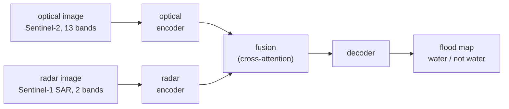
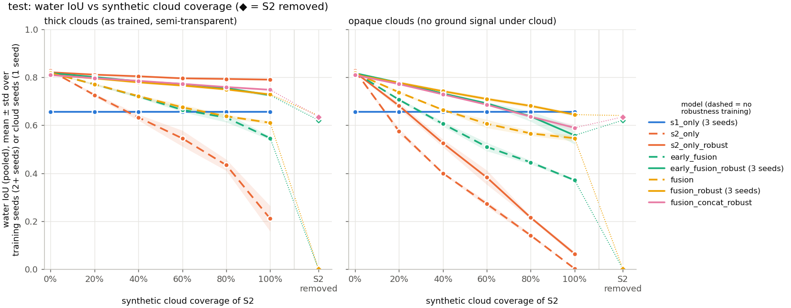
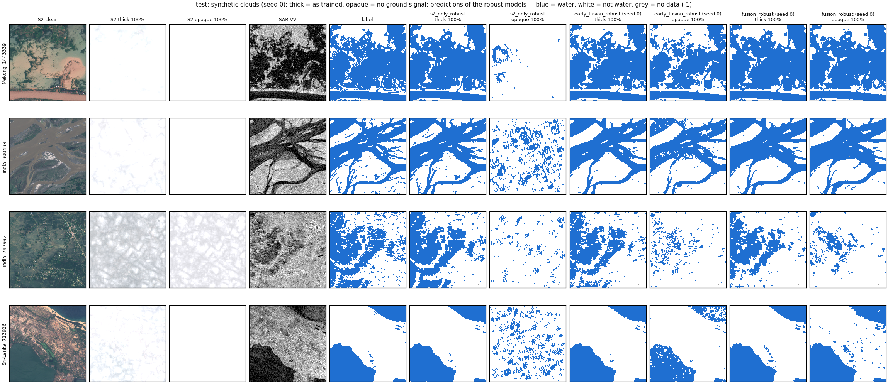

# floodfusion

Cloud-robust flood mapping by fusing Sentinel-1 SAR and Sentinel-2 optical imagery with deep
learning (Sen1Floods11). Final-year project.

**[▶ Try the live demo](https://huggingface.co/spaces/1ow1atency/floodfusion-demo)** — slide
synthetic cloud over a real flood scene and watch the optical-only model lose the water while
the radar-fusion model keeps mapping it.

**The headline:** under total opaque cloud, the fusion model holds a water IoU of
**0.644 ± 0.007** on the held-out test split, where an optical-only model trained the same way
collapses to **0.064**. It gives up 0.010 IoU in clear sky to get there.

## What this project is

Floods are mapped from satellites, but ordinary (optical) satellite photos cannot see through
clouds — and floods happen in exactly the cloudy, rainy weather that hides them. Radar
satellites (Sentinel-1 SAR) see through clouds day and night, but their images are grainier
and harder to read, so flood maps from radar alone are less accurate.

This project trains a deep learning model that reads both images of the same place at once:
each image type gets its own encoder (feature extractor), and the two exchange information
through cross-attention (each side learns what to take from the other) before a flood map is
produced. The aim is a model as accurate as an optical one in clear sky that keeps working as
clouds cover the scene.

It is trained and tested on the public Sen1Floods11 dataset — 446 hand-labelled satellite
scenes from 11 real flood events across six continents — and one flood (Bolivia) is held out
entirely: the model is evaluated there but never trained or tuned on it. Cloud robustness is
measured by covering the optical image with computer-generated (synthetic) clouds of growing
coverage at test time, so the same scene can be scored from 0% to 100% cloud.



## Key result

**Under fully opaque synthetic clouds on the test split, the robust two-encoder model
(`fusion_robust`) is the most accurate of every model that uses the optical image at each
coverage from 40% to 100%, and its lead over early fusion widens as the cloud thickens —
while the optical-only model collapses.**



Water IoU (intersection-over-union of the water class) on the 90 test chips under **opaque**
synthetic clouds. Source: [docs/results/](docs/results/) (`robustness_by_model.csv`),
14 runs over 8 configurations.

| model | seeds | clear sky | 40% cloud | 60% cloud | 80% cloud | 100% cloud |
|---|--:|--:|--:|--:|--:|--:|
| `s1_only` (radar only) | 3 | 0.656 ± 0.004 | 0.656 ± 0.004 | 0.656 ± 0.004 | 0.656 ± 0.004 | 0.656 ± 0.004 |
| `s2_only_robust` (optical only) | 1 | 0.821 | 0.526 ± 0.016 | 0.383 ± 0.030 | 0.215 ± 0.007 | 0.064 ± 0.009 |
| `early_fusion_robust` (channels stacked) | 3 | 0.817 ± 0.003 | 0.733 ± 0.003 | 0.692 ± 0.006 | 0.637 ± 0.021 | 0.558 ± 0.037 |
| **`fusion_robust` (two encoders + cross-attention)** | 3 | 0.811 ± 0.004 | **0.742 ± 0.008** | **0.710 ± 0.008** | **0.681 ± 0.008** | 0.644 ± 0.007 |
| `fusion_concat_robust` (ablation: no cross-attention) | 1 | 0.809 | 0.729 ± 0.003 | 0.686 ± 0.002 | 0.636 ± 0.004 | 0.590 ± 0.014 |

**The two ± values are not the same quantity.** For the three models trained with three seeds
it is the spread over **training seeds** — the one that says whether a gap is real. For the
single-seed models it is only the spread over the **3 synthetic cloud layouts**, so their
training variance is unmeasured; in clear sky, where no cloud is drawn, they have no spread
at all.

### What the numbers say

- **`fusion_robust` leads from 40% cloud upwards, and the lead grows.** Against
  `early_fusion_robust` it is ahead by 0.010 at 40%, 0.018 at 60%, 0.044 at 80% and 0.086 at
  100%. Weighed against the training-seed spread, only the last two are decisive: at 40% the
  gap is about the size of the two models' own seed spreads (± 0.008 and ± 0.003), while at
  80% and 100% it is two to twelve times larger than either.
- **It beats radar alone until the optical image is almost gone.** At 80% cloud it is 0.681
  against 0.656 for `s1_only`, a gap of 0.025 on seed spreads of ± 0.008 and ± 0.004. At 100%
  the advantage is gone: 0.644 against 0.656, i.e. 0.012 *below* radar-only, a difference of
  the same order as the seed spread. Fusion buys accuracy across the whole range of partial
  cloud, not a radar-beating result under total cloud.
- **It is far steadier across training seeds under heavy cloud.** At 100% opaque its spread is
  ± 0.007 against ± 0.037 for `early_fusion_robust` — about five times tighter. Early fusion's
  worst seed is what makes its average fall away; the two-encoder model behaves the same way
  every time it is trained.
- **Clear-sky accuracy costs almost nothing.** 0.811 against 0.817 for `early_fusion_robust`,
  a difference of 0.007 on seed spreads of ± 0.004 and ± 0.003, and 0.821 for the optical-only
  model.
- **Cross-attention, not just the two encoders, is what helps under heavy cloud.** The
  ablation keeps the separate encoders but fuses by concatenation: it trails `fusion_robust`
  at every cloud level above clear sky, by 0.013 at 40% rising to 0.045 at 80% and 0.055 at
  100%, which at 80-100% is several times `fusion_robust`'s seed spread. This is **one
  training seed**, so it is an indication rather than a measured effect.

### What the predictions look like



Four test chips at 100% cloud (training seed 0): the optical image as acquired, under thick
(training) cloud and under opaque cloud; then radar, the label, and each robust model's
prediction under both cloud types. On the chips dominated by wide, contiguous open water
(`Mekong_1443339`, `India_900498`, `Sri-Lanka_713926`) `fusion_robust` still traces the river
under opaque cloud, while `s2_only_robust` breaks down into speckle. `India_747992` is the
failure case: the flooding there is fragmented across a vegetated, partly built-up landscape
where water is not cleanly radar-dark, and under opaque cloud **all three robust models,
`fusion_robust` included, recover only scattered patches** of the labelled water. Radar does
not rescue every scene — it rescues the ones where water is dark and contiguous in SAR.

## Why opaque clouds, not the training clouds

The synthetic clouds used in training are semi-transparent: inside the cloud the image keeps
about 20% of the ground signal, and a water index computed under them still separates water
from land almost as well as in clear sky (measured in
[docs/cloud_leakage.md](docs/cloud_leakage.md)). A model can therefore learn to see water
*through* them: with no radar input at all, `s2_only_robust` scores **0.791** under 100% of
these clouds on the test split, and **0.064** once the same cloud masks are made fully opaque
(Bolivia: 0.783 against 0.051). A model with no way of seeing the ground cannot be 0.79
accurate, so that number measures leakage, not robustness. Thick-cloud results therefore
overstate optical robustness, and the headline evaluation uses **opaque** clouds — the same
cloud shapes with opacity 1, leaving no ground signal — with the thick results reported
alongside in [docs/results/summary.md](docs/results/summary.md).

## Status

- **Done:** data pipeline and normalisation; U-Net baselines (radar-only, optical-only, early
  fusion); FusionNet (two encoders + cross-attention); robustness training (synthetic clouds
  + modality dropout); **final robustness evaluation on test and Bolivia** — 14 runs over 8
  configurations, with 3 training seeds for `s1_only`, `early_fusion_robust` and
  `fusion_robust` ([docs/results/](docs/results/)); full-data audit of the s2cloudless cloud
  masks ([docs/cloud_audit.md](docs/cloud_audit.md)); an interactive demo (`app/`, Gradio) and
  the precomputed static build behind the
  [live Space](https://huggingface.co/spaces/1ow1atency/floodfusion-demo) (`static_demo/`).
- **Next:** the write-up. Figures and tables are final; nothing below is awaiting a run.

## Limitations

- **Bolivia is small and noisy.** The held-out region has only 15 chips, and its rankings
  disagree with the test split under heavy cloud. At 100% opaque cloud `fusion_robust` scores
  0.579 ± 0.034 there — above `early_fusion_robust` (0.462 ± 0.155, the widest seed spread
  anywhere in the evaluation) but **below radar-only** (`s1_only` 0.659 ± 0.043). The
  single-seed `fusion_concat_robust` reaches 0.643 on Bolivia, reversing the ordering it has
  on test. With 15 chips these differences are not separable from sampling noise, so Bolivia
  supports the generalisation question only weakly.
- **Only three configurations have more than one training seed.** `s2_only_robust`,
  `fusion_concat_robust` and the three non-robust baselines are one run each, so their ±
  covers the cloud layouts alone. The cross-attention ablation in particular rests on a
  single seed.
- **Labels are missing under real clouds.** The human annotators could not see through clouds
  either: on the test split about half of the really-cloudy pixels are unlabelled and very few
  are labelled water (3.3%, against 12.9% of clear pixels). Scores on really-cloudy images
  therefore only reflect the visible parts — which is why the synthetic opaque clouds, applied
  over fully labelled clear scenes, are the main experiment and the real-cloud bins
  ([real_cloud_bins.png](docs/figures/real_cloud_bins.png)) are **supporting evidence only**.
  The cloudiest bin holds 11 test chips, 9 once the flagged ones are excluded.
- **The cloud detector itself fails on some chips.** On 10 chips (mostly from the Paraguay
  flood) s2cloudless reports ~100% cloud over plainly visible ground, traced to an elevated
  cirrus band (B10) in the source data; 2 of them are in the test split
  (`Paraguay_913449`, `Sri-Lanka_1049830`) and every real-cloud table is reported with and
  without them. The detector also over-flags haze and bright bare ground at its default
  threshold; a stricter-threshold variant is provided as a sensitivity check
  ([docs/cloud_audit.md](docs/cloud_audit.md)).
- **Synthetic clouds are not real clouds.** They carry no shadows and no surrounding haze, and
  the opaque variant is deliberately harsher than most real cloud. It is a controlled stress
  test of how much the model leans on the optical image, not a forecast of accuracy over a
  real overcast flood.

## Repository layout

```
src/floodfusion/   the package (all logic lives here)
  data.py, chips.py      Sen1Floods11 dataset; missing-value, clipping and normalisation rules
  stats.py               normalisation statistics (train split only)
  clouds.py              real cloud cover per chip (s2cloudless, optional `clouds` extra)
  cloud_audit.py         audit of the s2cloudless masks: thresholds, labels under cloud, unreliable-mask flag
  clouds_synth.py        synthetic clouds for Sentinel-2 (robustness training; opaque variant for evaluation)
  cloud_leakage.py       how much ground signal survives under the synthetic clouds
  transforms.py          crops/flips/rotations, synthetic clouds, modality dropout
  models.py              U-Net baselines and FusionNet
  losses.py, metrics.py  cross-entropy + Dice loss; water IoU from pooled confusion counts
  training.py, evaluation.py   training loop (checkpoints, resume, W&B) and evaluation
  robustness.py          robustness evaluation: synthetic clouds, missing modality, real-cloud bins
  viz.py                 figures
scripts/           thin command-line entry points (train.py, evaluate.py, compute_stats.py, ...)
configs/           one YAML per experiment, plus band_stats.json (normalisation statistics)
notebooks/         thin Colab launchers: 00 download data, 01 stats, 02 cloud cover, 03 train,
                   04 robustness evaluation, 05 cloud-mask audit (CPU)
tests/             pytest suite on tiny synthetic GeoTIFFs (never the real dataset)
app/               interactive Gradio demo (Hugging Face Space); weights are not in git
static_demo/       precomputed, server-free build of the same demo (static Space)
docs/              ROADMAP.md, results tables, cloud-cover tables, figures
```

Data, checkpoints and W&B run folders are not in git. They live on Google Drive, and their
paths come from the configs or the command line.

## Run locally (CPU)

```bash
python3.11 -m venv .venv && source .venv/bin/activate
pip install -e ".[dev]"
pytest
```

The tests are fast on a CPU and need no data.

A **smoke run** checks that the full training path works on a few local chips. It needs a
local sample of the dataset under `data/sen1floods11/`:

```bash
python scripts/train.py --config configs/early_fusion.yaml --root data/sen1floods11 \
    --out outputs/runs --smoke --no-wandb
```

The smoke run trains for one epoch of 2 batches and "validates" on 2 train chips. It prints
a warning because its numbers are not a result. Any config in `configs/` works.

## Training

Full training, the robustness evaluation and the cloud-mask audit run on Colab (GPU for
training and evaluation, CPU for the cloud-mask audit) — see
[docs/colab_setup.md](docs/colab_setup.md) for the notebook workflow and one-time setup.

## Dataset and citation

This project uses the hand-labelled subset of **Sen1Floods11** (v1.1):

> Bonafilia, D., Tellman, B., Anderson, T., & Issenberg, E. (2020). Sen1Floods11: a
> georeferenced dataset to train and test deep learning flood algorithms for Sentinel-1.
> In *Proceedings of the IEEE/CVF Conference on Computer Vision and Pattern Recognition
> Workshops (CVPRW)*, pp. 210–211.

```bibtex
@inproceedings{bonafilia2020sen1floods11,
  title     = {Sen1Floods11: a georeferenced dataset to train and test deep learning flood algorithms for Sentinel-1},
  author    = {Bonafilia, Derrick and Tellman, Beth and Anderson, Tyler and Issenberg, Erica},
  booktitle = {Proceedings of the IEEE/CVF Conference on Computer Vision and Pattern Recognition Workshops (CVPRW)},
  pages     = {210--211},
  year      = {2020}
}
```
