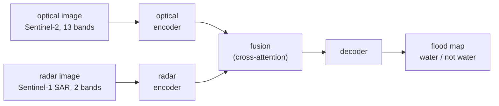

# floodfusion

Cloud-robust flood mapping by fusing Sentinel-1 SAR and Sentinel-2 optical imagery with deep
learning (Sen1Floods11).

> **Interim README.** Work in progress: every result so far is from a single training seed.
> Multi-seed runs are underway; final results will replace the tables below.

## What this project is

Floods are mapped from satellites, but ordinary (optical) satellite photos cannot see through
clouds — and floods happen in exactly the cloudy, rainy weather that hides them. Radar
satellites (Sentinel-1 SAR) see through clouds day and night, but their images are grainier
and harder to read, so flood maps from radar alone are less accurate. This project trains a
deep learning model that reads both images of the same place at once: each image type gets
its own encoder (feature extractor), and the two exchange information through cross-attention
(each side learns what to take from the other) before a flood map is produced. The aim is a
model as accurate as an optical one in clear sky that keeps working as clouds cover the
scene. It is trained and tested on the public Sen1Floods11 dataset — 446 hand-labelled
satellite scenes from 11 real flood events across six continents — and one flood (Bolivia)
is held out entirely: the model is evaluated there but never trained or tuned on it. Cloud
robustness is measured by covering the optical image with computer-generated (synthetic)
clouds of growing coverage at test time, so the same scene can be scored from 0% to 100%
cloud.



## Key result (training seed 0, preliminary)

**Under fully opaque synthetic clouds on the test split, the robust two-encoder model
(`fusion_robust`) is the most accurate of all seven models at every coverage from 20% to 80%,
and at 100% cloud it is level with radar-only — while the optical-only model collapses.**

*(figure pending: copy `results/iou_vs_coverage_test.png` from Drive into
`docs/figures/iou_vs_coverage_test.png` — the line below will then render)*


Water IoU (intersection-over-union of the water class) on the 90 test chips under **opaque**
synthetic clouds, averaged over 3 cloud layouts. **Training seed 0 — preliminary** (source:
[docs/results/](docs/results/)):

| model | clear sky | 40% cloud | 80% cloud | 100% cloud |
|---|--:|--:|--:|--:|
| s1_only (radar only) | 0.657 | 0.657 | 0.657 | 0.657 |
| s2_only_robust (optical only) | 0.821 | 0.526 | 0.215 | 0.064 |
| early_fusion_robust (channels stacked) | 0.819 | 0.730 | 0.616 | 0.530 |
| **fusion_robust (two encoders + cross-attention)** | 0.813 | **0.750** | **0.687** | 0.650 |

The fusion model pays almost nothing in clear sky (0.813 vs 0.821 optical-only) and keeps
most of its accuracy as the optical image disappears.

## Why opaque clouds, not the training clouds

The synthetic clouds used in training are semi-transparent: inside the cloud the image keeps
about 20% of the ground signal, and a water index computed under them still separates water
from land almost as well as in clear sky (measured in
[docs/cloud_leakage.md](docs/cloud_leakage.md)). A model can therefore learn to see water
*through* them: the optical-only robust model scores 0.79 under 100% of these clouds, but
0.06 once the same clouds are made fully opaque. Thick-cloud results overstate optical
robustness, so the headline evaluation uses **opaque** clouds — the same cloud shapes with
opacity 1, leaving no ground signal — and reports the thick results alongside.

## Status

- **Done:** data pipeline and normalisation; U-Net baselines (radar-only, optical-only, early
  fusion); FusionNet (two encoders + cross-attention); robustness training (synthetic clouds
  + modality dropout); robustness evaluation on test and Bolivia (seed 0, in
  [docs/results/](docs/results/)); full-data audit of the s2cloudless cloud masks
  ([docs/cloud_audit.md](docs/cloud_audit.md)).
- **In progress:** training seeds 1–2 for the main models and a concat-fusion ablation
  (`fusion_concat_robust`, seeds 0–2) — run plan and rough GPU times in
  [docs/ROADMAP.md](docs/ROADMAP.md); then final multi-seed results, and a small demo that
  runs a trained model on a chosen scene.

## Limitations

- **Single training seed.** Every number above is one training run per model; the ± spread in
  `docs/results/` covers only the random cloud layouts, not training variance.
- **Labels are missing under real clouds.** The human annotators could not see through
  clouds either: on the test split about half of the really-cloudy pixels are unlabelled and
  very few are labelled water (3.3%, against 12.9% of clear pixels). Scores on really-cloudy images therefore only reflect the
  visible parts — which is why the synthetic opaque clouds, applied over fully labelled
  clear scenes, are the main experiment and the real-cloud tables are supporting evidence.
- **The cloud detector itself fails on some chips.** On 10 chips (mostly from the Paraguay
  flood) s2cloudless reports ~100% cloud over plainly visible ground, traced to an elevated
  cirrus band (B10) in the source data; these chips are flagged and all real-cloud tables
  are reported with and without them. The detector also over-flags haze and bright bare
  ground at its default threshold; a stricter-threshold variant is provided as a sensitivity
  check ([docs/cloud_audit.md](docs/cloud_audit.md)).
- **Bolivia is small.** The held-out region has only 15 chips, so its numbers are noisy and
  its model ranking can disagree with the test split at single coverages.

## Repository layout

```
src/floodfusion/   the package (all logic lives here)
  data.py, chips.py      Sen1Floods11 dataset; missing-value, clipping and normalisation rules
  stats.py               normalisation statistics (train split only)
  clouds.py              real cloud cover per chip (s2cloudless, optional `clouds` extra)
  cloud_audit.py         audit of the s2cloudless masks: thresholds, labels under cloud, unreliable-mask flag
  clouds_synth.py        synthetic clouds for Sentinel-2 (robustness training; opaque variant for evaluation)
  cloud_leakage.py       how much ground signal survives under the synthetic clouds
  transforms.py          crops/flips/rotations, synthetic clouds, modality dropout
  models.py              U-Net baselines and FusionNet
  losses.py, metrics.py  cross-entropy + Dice loss; water IoU from pooled confusion counts
  training.py, evaluation.py   training loop (checkpoints, resume, W&B) and evaluation
  robustness.py          robustness evaluation: synthetic clouds, missing modality, real-cloud bins
  viz.py                 figures
scripts/           thin command-line entry points (train.py, evaluate.py, compute_stats.py, ...)
configs/           one YAML per experiment, plus band_stats.json (normalisation statistics)
notebooks/         thin Colab launchers: 00 download data, 01 stats, 02 cloud cover, 03 train,
                   04 robustness evaluation, 05 cloud-mask audit (CPU)
tests/             pytest suite on tiny synthetic GeoTIFFs (never the real dataset)
docs/              ROADMAP.md, label and cloud-cover tables, figures
```

Data, checkpoints and W&B run folders are not in git. They live on Google Drive, and their
paths come from the configs or the command line.

## Run locally (CPU)

```bash
python3.11 -m venv .venv && source .venv/bin/activate
pip install -e ".[dev]"
pytest
```

The tests are fast on a CPU and need no data.

A **smoke run** checks that the full training path works on a few local chips. It needs a
local sample of the dataset under `data/sen1floods11/`:

```bash
python scripts/train.py --config configs/early_fusion.yaml --root data/sen1floods11 \
    --out outputs/runs --smoke --no-wandb
```

The smoke run trains for one epoch of 2 batches and "validates" on 2 train chips. It prints
a warning because its numbers are not a result. Any config in `configs/` works.

## Train on Colab

Training runs on a Colab GPU (T4) with `notebooks/03_train.ipynb`.

1. Do the one-time setup in [Colab setup](#colab-setup) below (GitHub token secret).
2. Run `00_download_data.ipynb` once to put Sen1Floods11 on Google Drive.
3. Run `01_compute_stats.ipynb` once to compute the normalisation statistics.
4. In notebook 03, change only the settings cell (config and seed). It trains, resumes
   automatically after a disconnect, and evaluates `best.pt` on valid, test and bolivia.

Never change hyperparameters based on test or bolivia results.

After all runs are trained and evaluated, `notebooks/04_evaluate.ipynb` runs the robustness
evaluation (`scripts/robustness_eval.py`) over every run folder and writes `robustness.csv`
(one row per run), `robustness_by_model.csv`, `summary.md` and figures to
`floodfusion/results/` on Drive. Runs of one config with different seeds
(`fusion_robust_seed0`, `_seed1`, ...) are grouped: tables and figures show mean ± std over
training seeds, with the per-run tables kept. It sweeps cloud coverage for
thick clouds (as trained) and opaque clouds (the stricter test), and also evaluates with S2
removed. Expect about 15-25 min on a T4. This is final reporting only.

`notebooks/05_cloud_audit.ipynb` (CPU runtime) audits the s2cloudless masks behind the
real-cloud bins (`scripts/audit_clouds.py`); this has been run on the full data, with the
findings in [docs/cloud_audit.md](docs/cloud_audit.md). `scripts/flag_cloud_masks.py` turns
its `chip_audit.csv` into the `mask_unreliable` flags in `docs/cloud_cover.csv` and the 0.6
sensitivity file `docs/cloud_cover_t06.csv`.

## Dataset and citation

This project uses the hand-labelled subset of **Sen1Floods11** (v1.1):

> Bonafilia, D., Tellman, B., Anderson, T., & Issenberg, E. (2020). Sen1Floods11: a
> georeferenced dataset to train and test deep learning flood algorithms for Sentinel-1.
> In *Proceedings of the IEEE/CVF Conference on Computer Vision and Pattern Recognition
> Workshops (CVPRW)*, pp. 210–211.

```bibtex
@inproceedings{bonafilia2020sen1floods11,
  title     = {Sen1Floods11: a georeferenced dataset to train and test deep learning flood algorithms for Sentinel-1},
  author    = {Bonafilia, Derrick and Tellman, Beth and Anderson, Tyler and Issenberg, Erica},
  booktitle = {Proceedings of the IEEE/CVF Conference on Computer Vision and Pattern Recognition Workshops (CVPRW)},
  pages     = {210--211},
  year      = {2020}
}
```

## Colab setup

Notebooks in `notebooks/` are thin Colab launchers. Each one clones (or pulls) this repo into
`/content/floodfusion` with the shared cell in `notebooks/colab_clone_cell.py`.

### GitHub token (needed while the repo is not publicly visible)

1. On GitHub: Settings → Developer settings → Personal access tokens → Fine-grained tokens →
   Generate new token. Repository access: *Only select repositories* → `floodfusion`;
   Permissions: *Contents: Read-only*. Set an expiry date.
2. In Colab: click the **key icon** (Secrets) in the left sidebar → **Add new secret** →
   Name `GITHUB_TOKEN`, Value = the token.
3. Switch **Notebook access** on for that secret. Colab asks again for each new notebook.
4. Re-run the clone cell.

The token is passed to git only through environment variables. It is never printed (it is
masked as `***` in error output), never put on the command line and never written to
`.git/config`. If the secret is missing, the cell prints how to add it and tries a plain
public clone instead.

### Opening a notebook when the GitHub link does not work

1. Locally: `git pull` so your copy of the repo is up to date.
2. In Colab: **File → Upload notebook** → pick e.g. `notebooks/02_cloud_cover.ipynb` from your
   local repo.

The uploaded notebook is a copy saved in your Drive (`Colab Notebooks/`). It does not update
when the repo changes, so upload it again after notebook changes. The code it runs is always
the latest, because the clone cell pulls the repo.
